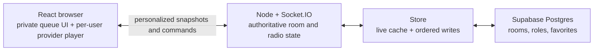

# Rooms and radio architecture

This document explains the room lifecycle, DJ rotation, private queues,
playback authority, disconnect behavior, and Supabase persistence. Read it
before changing `server/index.ts`, `server/radio.ts`, or the room types.

Chat has a separate transport and persistence model. See [Chat
architecture](chat.md).

## Terminology

The word “DJ” describes three different states. Keeping them separate prevents
most authorization and rotation bugs.

| Term | Meaning |
| --- | --- |
| Listener | A user with a live Socket.IO connection to the room. |
| Eligible DJ | A user allowed to join the lineup. In an open room this is everyone; in a role-restricted room it is the owner, a moderator, or a user with the DJ role. |
| Joined DJ | A user whose ID is in `djQueueUserIds`. They may be waiting, on air, or temporarily disconnected. |
| Current DJ / on-air DJ | The user in `djUserId`, whose track is currently playing. |
| Playback controller | The current DJ, owner, or moderator. |

A DJ role is permission, not lineup membership. Granting the role does not join
the user, and joining the lineup does not make the user immediately current.

## Architecture



The Node server is authoritative for the radio. Browsers send commands, but
they never directly decide the next track, role eligibility, or shared playback
state. The server validates each command, mutates the room, persists it, and
then broadcasts a new personalized snapshot.

This is currently a **single active Node instance** design. Presence maps,
cached DJ identities, disconnect timers, and Socket.IO fan-out live in one
process. Supabase makes room state durable, but does not coordinate multiple
Lydman server replicas. Add a shared Socket.IO adapter, distributed locks,
and durable grace scheduling before horizontally scaling the server.

## Code map

| File | Responsibility |
| --- | --- |
| `server/index.ts` | HTTP and Socket.IO entry point, validation, authorization, presence, grace-period lifecycle, and command handlers. |
| `server/radio.ts` | Radio state normalization, DJ eligibility, round-robin advancement, private queue access, and snapshot privacy. |
| `server/store.ts` | Live room cache, Supabase reads/writes, room directory, roles, favorites, profiles, and ordered persistence. |
| `server/types.ts` | Authoritative server room and snapshot shapes. |
| `server/radio.test.ts` | Focused tests for rotation, privacy, legacy migration, and disconnect timers. |
| `src/types.ts` | Client mirror of the safe snapshot types. It intentionally has no `djQueues` map. |
| `src/App.tsx` | Socket lifecycle, room screen, personalized snapshot consumption, player controls, and DJ queue UI. |
| `src/components/RoomSettingsDialog.tsx` | Room metadata, DJ access mode, moderator, and DJ-role controls. |
| `src/components/YouTubePlayer.tsx` | YouTube playback synchronization and natural track-ended reporting. |
| `src/components/SoundCloudPlayer.tsx` | SoundCloud Widget playback synchronization and natural track-ended reporting. |
| `src/components/SpotifyPlayer.tsx` | Spotify Web Playback SDK or remote Spotify Connect synchronization. |
| `src/components/AppleMusicPlayer.tsx` | MusicKit authorization and per-listener Apple Music playback. |
| `server/soundcloud.ts` | Server-only OAuth token management and SoundCloud catalog search adapter. |
| `server/spotify.ts` | Spotify catalog, OAuth token exchange, and Web API requests. |
| `server/apple-music.ts` | Apple developer-token signing and catalog access. |
| `server/provider-mappings.ts` | ISRC-first and confidence-scored cross-provider recording resolution. |
| `supabase/migrations/20260716213000_initial_soundspin.sql` | Base room table and initial security. |
| `supabase/migrations/20260716220542_room_directory.sql` | Directory metadata, memberships, favorites, and settings. |
| `supabase/migrations/20260719151147_add_dj_role.sql` | Adds the room-level DJ role. |

## Room state

`Room` is the server's authoritative persisted document. The important radio
fields are:

| Field | Meaning | Sent to clients? |
| --- | --- | --- |
| `ownerUserId` | Room owner. | Yes |
| `moderatorUserIds` | Users who can manage settings and playback. | Yes |
| `djRoleUserIds` | Users eligible in role-restricted mode. | Yes |
| `settings.djAccess` | `everyone` or `roles`. | Yes |
| `djUserId` | Current on-air DJ. | Yes |
| `djQueueUserIds` | Rotating DJ lineup; index 0 is the next candidate. | Yes |
| `djQueues[userId]` | Every DJ's private upcoming tracks. | **Never** |
| `playback` | Current track, playing state, position, and update timestamp. | Yes |
| `history` | Up to 100 recently completed tracks. | Yes |
| `vibe` | Votes for the current track instance. | Yes |

The following state is process-only and is not stored as part of the room:

- `roomUsers`: live socket presence, keyed by room and socket ID.
- `roomDjUsers`: display identities for joined DJs, retained during grace.
- `socketRooms`: the room currently associated with each socket.
- `djEvictions`: one-minute disconnect timers.
- YouTube search cache and rate limits.

### Queue privacy boundary

`roomForListener(room, userId)` is the only supported conversion from the
authoritative room to `SnapshotRoom`. It removes the full `djQueues` map and
exposes only `djQueues[userId]` under the client-facing name `queue`.

`broadcast(room)` therefore loops over sockets and creates a separate snapshot
for each recipient. Replacing it with one `io.to(room).emit(...)` payload would
leak private queues. New APIs, logs, debug endpoints, and telemetry must also
avoid serializing the authoritative `Room` object to a browser or third party.

`SnapshotRoom` on the server and `Room` in `src/types.ts` deliberately have
different shapes:

- Server: `djQueues: Record<userId, Track[]>`.
- Client: `queue: Track[]`, already filtered for that recipient.

## Joining a room

The browser connects Socket.IO and emits `room:join`. The server then:

1. Validates the room ID and profile payload with Zod.
2. Uses the verified Supabase JWT user ID instead of trusting the payload ID.
3. Checks room existence, visibility/membership, and the scrypt password hash.
4. Loads the room from the live cache or Supabase.
5. Calls `normalizeRadioState` to repair old or incomplete persisted state.
6. Records basic membership without downgrading an existing elevated role.
7. Adds the socket to presence and cancels this user's pending DJ eviction.
8. Removes lineup entries that are neither online nor covered by a live grace
   timer. This cleans stale persisted DJs after a server restart.
9. Persists normalized state, joins the Socket.IO room, and broadcasts
   personalized snapshots.

Listener count is the number of distinct connected user IDs, not the number of
tabs or sockets. `roomUsers` remains socket-based internally, but `uniqueUsers`
projects it into one entry per account before snapshots or directory counts are
created.

A join is transactional with respect to presence. Rejoining the same room on an
already connected socket refreshes that presence without scheduling disconnect
grace. When switching rooms, the server keeps the old membership until the new
room has passed authentication, access checks, and loading. This prevents a
temporary database/auth failure from making an active tab look disconnected.

## DJ rotation

`djQueueUserIds` behaves as a ring. `advanceRadio` checks at most one complete
lap:

1. Archive the previous track, retaining at most 100 history entries.
2. Remove the first DJ ID and append it to the back of the lineup.
3. Take one track from that DJ's private queue.
4. If the queue is empty, continue to the next DJ without removing anyone.
5. When a track is found, set `djUserId`, replace `playback`, and reset `vibe`.
6. If the full lap has no music, clear the current DJ and make the room quiet.

Example with lineup `[Alice, Bob, Casey]`:

- Alice plays one song; lineup becomes `[Bob, Casey, Alice]`.
- Bob has no tracks, so Bob rotates to the back.
- Casey plays one song; lineup becomes `[Alice, Bob, Casey]`.
- Bob remains joined and will be considered again after Alice.

This produces one song per DJ per turn while allowing joined DJs to temporarily
have an empty queue.

### Joining and leaving the lineup

`dj:join` verifies `canJoinDjQueue`, creates the user's private queue, remembers
their display identity, and starts the radio if it is quiet. A newcomer is
inserted before the current DJ's next turn, so already-waiting DJs retain their
place.

`dj:leave` is explicit intent and takes effect immediately. It cancels any grace
timer, removes the DJ, and advances immediately if they were on air. Their
private tracks remain in `djQueues`; rejoining restores access to that queue.

Changing a room to role-restricted access, removing a DJ role, or removing a
moderator also ejects users who are no longer eligible. If an ejected user is
current, the server advances the radio.

## Disconnect and reconnect grace

Closing a tab, navigating away, losing the network, and a Socket.IO disconnect
all use the same path:

1. Remove only that socket from presence.
2. If another socket for the same user remains, do nothing to their DJ state.
3. If the user's last socket left and they are joined as a DJ, start one
   60-second timer keyed by `roomId:userId`.
4. Keep the DJ in the lineup and keep their identity visible during the grace.
5. If they reconnect in time, cancel the timer and preserve their exact place.
6. At expiry, re-check presence to avoid a reconnect race. If still offline,
   remove them. If they were current, advance to the next available song.

Grace timers are memory-only. A process restart loses them; the next room join
prunes persisted DJs who are offline and have no pending timer. If grace must
survive deploys, persist an `evict_after` timestamp and run eviction through a
shared scheduler before adding multiple server instances.

## Playback synchronization

The room stores a playback checkpoint:

```text
position at updatedAt + elapsed wall-clock time (when playing)
```

Clients use the checkpoint to seek their selected provider player into sync.
Each listener may use the room source, Spotify in Lydman, Spotify Desktop,
or Apple Music. Provider mappings are stored with the track; missing mappings
fall back to the source provider. Only the current DJ's active adapter reports
a natural end. The current DJ, owner, and moderators may pause, seek, or skip.

`queue:next` must include the current track UUID. The server advances only when
that UUID still matches `playback.track.id`. This makes ended/skip commands
idempotent: retries, delayed events, or another tab cannot accidentally skip
the next song too.

Do not use a provider video ID for this check. The Lydman track UUID
identifies one play instance, even if the same provider track appears later.

## Permissions

| Action | Listener | Joined DJ | Current DJ | DJ role | Moderator | Owner |
| --- | ---: | ---: | ---: | ---: | ---: | ---: |
| Listen and vote on another user's track | Yes | Yes | Yes | Yes | Yes | Yes |
| Join an open DJ lineup | Yes | — | — | Yes | Yes | Yes |
| Join a role-restricted DJ lineup | No | — | — | Yes | Yes | Yes |
| Edit own private queue | No | Yes | Yes | Only after joining | Only after joining | Only after joining |
| Pause, seek, or skip | No | No | Yes | No | Yes | Yes |
| Change room metadata or DJ access mode | No | No | No | No | Yes | Yes |
| Grant/revoke moderator or DJ roles | No | No | No | No | No | Yes |

All authorization is repeated on the server. Hiding a button in React is not a
security boundary.

## Socket.IO contract

Every command accepts an acknowledgement callback shaped like
`{ ok: boolean, error?: string, ... }`.

| Event | Payload | Main effect |
| --- | --- | --- |
| `room:join` | `{ roomId, roomName?, password?, user }` | Authenticate, load access, establish presence, restore grace, send snapshots. |
| `room:moderator:set` | `{ userId, moderator }` | Owner grants or revokes moderator role. |
| `room:dj-role:set` | `{ userId, dj }` | Owner grants or revokes DJ role. |
| `dj:join` | none | Eligible listener joins the rotation. |
| `dj:leave` | none | DJ explicitly leaves immediately. |
| `queue:add` | `{ provider, providerId, title }` | Add a unique track instance to the sender's private queue. |
| `queue:remove` | `{ trackId }` | Remove from the sender's queue. |
| `queue:play-next` | `{ trackId }` | Move a sender-owned queued track to index 0. |
| `queue:move` | `{ trackId, toIndex }` | Reorder the sender's queue. |
| `queue:next` | `{ trackId }` | End the matching current track and rotate. |
| `playback:update` | `{ playing, position }` | Save an authorized playback checkpoint. |
| `vibe:vote` | `{ value: -1 \| 0 \| 1 }` | Set/remove the listener's vote for the current track. |
| `room:snapshot` | server event | Personalized room, presence, DJ identities, and server time. |

Add new events in this order: define a Zod schema, resolve membership from the
socket, authorize on the server, mutate authoritative state, await persistence,
broadcast personalized state, then acknowledge success.

## HTTP room API

Authenticated requests use the Supabase access token as a bearer token.

| Endpoint | Purpose |
| --- | --- |
| `GET /api/rooms` | Visible/favorite/member room directory plus live listener counts. |
| `POST /api/rooms` | Create a room, hash an optional password, and favorite it for the owner. |
| `PUT /api/rooms/:slug/favorite` | Add or remove the current user's favorite. |
| `PATCH /api/rooms/:slug` | Owner/moderator changes name, visibility, password, or DJ access mode. |
| `GET /api/youtube/search` | Authenticated, cached server-side YouTube search; the API key stays secret. |
| `GET /api/soundcloud/search` | Authenticated, cached server-side SoundCloud search; client credentials and OAuth tokens stay secret. |
| `GET /api/soundcloud/resolve` | Authenticated SoundCloud URL resolution; only playable public tracks are returned. |
| `GET /api/spotify/search`, `GET /api/spotify/resolve` | Spotify catalog search and URL/URI resolution. |
| `GET /api/apple/search`, `GET /api/apple/resolve` | Storefront-aware Apple Music catalog search and URL resolution. |
| `GET /api/music/connections` | Current listener's provider readiness without exposing credentials. |
| `GET /api/spotify/connect`, `GET /api/spotify/callback` | Stateful Spotify authorization-code flow. |
| `GET /api/spotify/devices` | Available Spotify Connect devices for the linked listener. |
| `GET /api/spotify/playback`, `POST /api/spotify/playback` | Read or command the linked listener's playback. |
| `GET /api/apple/token` | Short-lived Apple developer token used to configure MusicKit. |

Room role changes use Socket.IO because connected clients need an immediate
snapshot. Room metadata changes use HTTP and explicitly broadcast after the
database/cache update.

## Supabase persistence and security

Production assumes Supabase is enabled. `Store` still contains a JSON fallback
for legacy/local compatibility, but deployed room behavior should be tested
against Supabase and the required environment variables must remain configured.

Room data is split deliberately:

- `soundspin_rooms.state` stores the fast-changing `Room` JSON document:
  rotation, queues, playback, history, and vibe state.
- First-class `soundspin_rooms` columns store directory and access metadata:
  slug, name, owner, visibility, password hash, and settings.
- `soundspin_room_members` stores owner, moderator, DJ, and member roles.
- `soundspin_room_favorites` stores each user's directory favorites.
- `soundspin_music_connections` stores encrypted, server-only Spotify refresh
  tokens. Browser roles have no grants or RLS policies for this table.

On load, first-class columns and membership rows override duplicated fields in
the JSON document. They are the authorization and directory source of truth.

`Store.saveRoom` updates the live cache immediately and serializes persistence
through `writeChain`. Await its returned promise before acknowledging a command;
otherwise a slow older write could win over a newer radio transition.

The server uses a secret Supabase client. The secret key must never be exposed
through a `VITE_` variable, browser bundle, snapshot, or log. Browser access to
room state tables is restricted; server-side handlers enforce room permissions.
Chat is the exception: authenticated browser clients access its tables through
the publishable key and RLS, as described in `docs/chat.md`.

Never edit a migration already deployed to production. Add a new timestamped
file under `supabase/migrations` and deploy it through the configured Supabase
workflow.

## Invariants to preserve

Treat these as design requirements when reviewing a room/radio change:

1. One successful `advanceRadio` consumes at most one track from one DJ.
2. A DJ rotates to the back before the next candidate is checked.
3. Empty private queues are skipped, not removed from the lineup.
4. `djUserId` matches the owner of the current track after normalization.
5. No snapshot contains `djQueues` or another user's queued tracks.
6. Explicit DJ leave is immediate; an involuntary disconnect gets 60 seconds.
7. Reconnecting within grace preserves lineup position and current playback.
8. Stale `queue:next` events cannot advance a different track.
9. Role-restricted rooms allow only owner, moderator, or DJ-role users to join.
10. Every mutation is authorized server-side, persisted, then broadcast.

## Making changes safely

### Add a room field

1. Add it to `server/types.ts`.
2. Decide whether it is authoritative/private or safe for snapshots.
3. Initialize it in `createRoom`.
4. Add compatibility defaults to `normalizeRadioState` if old rooms lack it.
5. Mirror only the safe shape in `src/types.ts`.
6. Check `Store.loadRoom` precedence between JSON and first-class columns.
7. Add a migration if relational columns, indexes, roles, or policies change.
8. Add a focused test and update this document.

### Change queue or rotation behavior

Keep pure state transitions in `server/radio.ts`, not inside a socket handler.
Extend `server/radio.test.ts` with a concrete lineup and expected order. Include
empty queues, removal of the current DJ, and private snapshot coverage when
relevant.

### Add a role or permission

Update the membership constraint with a new migration, server/store types,
load/save mapping, settings UI, handler authorization, eligibility cleanup, and
the permissions table above. Decide explicitly what happens to a current DJ
when permission is revoked.

## Troubleshooting

### A listener can see another DJ's queued tracks

Inspect `roomForListener` and every place that emits `room:snapshot`. Search for
serialization of a full `Room` or direct use of `djQueues` outside server code.
Run the radio privacy test immediately.

### The radio skips two songs

Confirm every `queue:next` sender includes the current Lydman track UUID and
that the server still compares it before advancing. Check whether more than the
on-air browser reports natural YouTube completion.

### A DJ disappears on a short refresh

Confirm the disconnect path calls `scheduleDjEviction`, another tab is checked,
and `room:join` calls `cancelDjEviction` before pruning the lineup. Verify the
configured delay remains `60_000` milliseconds.

### A disconnected current DJ never advances

Check server logs for a failed `saveRoom` inside the eviction callback. Confirm
the server process stayed alive for the full minute and remember that timers do
not survive deploys or restarts.

### A role change does not eject an ineligible DJ

Check both role handlers and `PATCH /api/rooms/:slug`. Each restriction path
must filter the lineup, cancel eviction timers, forget cached DJ identity,
advance if the current DJ was removed, persist, and broadcast.

### Supabase has newer metadata but the room shows old values

Inspect `Store.loadRoom`. First-class columns and membership rows must override
the cached JSON document. Also confirm no stale long-running Node instance is
holding an older live room object.

## Verification

Run these after room or radio changes:

```bash
npm run test:radio
npm run test:music
npm run typecheck
npm run build
```

For manual testing, use two authenticated users in separate browser profiles:

1. Join both to the DJ lineup and add two tracks each.
2. Confirm neither can see the other's private queue.
3. Confirm turns alternate one song at a time.
4. Refresh the current DJ and reconnect within one minute; their place remains.
5. Close the current DJ for more than one minute; they are removed and playback
   advances.
6. Switch the room to role-restricted mode and verify only owner, moderator, and
   DJ-role users can join.
7. Revoke the current DJ's role and verify immediate removal and advancement.
