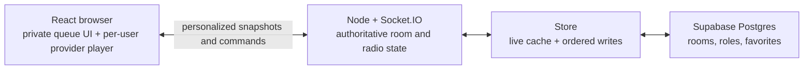

# Rooms and radio architecture

This document explains the room lifecycle, DJ rotation, private queues,
playback authority, disconnect behavior, and Supabase persistence. Read it
before changing `server/index.ts`, `server/features/rooms/radio.ts`, or the room types.

Chat has a separate transport and persistence model. See [Chat
architecture](chat.md).

## Terminology

The word “DJ” describes three different states. Keeping them separate prevents
most authorization and rotation bugs.

| Term | Meaning |
| --- | --- |
| Listener | A user with a live Socket.IO connection to the room. |
| Eligible DJ | A user allowed by DJ eligibility, rules acceptance, restrictions, join lock, and capacity. In role-restricted rooms the owner, moderators, and DJ-role holders meet the role requirement. |
| Joined DJ | A user whose ID is in `djQueueUserIds`. They may be waiting, on air, or temporarily disconnected. |
| Current DJ / on-air DJ | The user in `djUserId`, whose track is currently playing. |
| Playback controller | The owner, a moderator with playback permission, or the current DJ when the room permits current-DJ controls. |

A DJ role is permission, not lineup membership. Granting the role does not join
the user, and joining the lineup does not make the user immediately current.

`settings.allowedProviders` limits queue sources and listener playback services.
Missing settings allow all services. Owners and moderators with music-policy permission can save a nonempty
list; the settings and any resulting playback advance commit together. Disabled
waiting tracks remain in private queues and are skipped in DJ rotation. Adds,
saved-set imports, Undo, and Play next recheck the current policy on the server.

Mixcloud shows use source playback without song catalog matching. The visible
widget supports playback status and seeks, but seeks can be refused and there
is no SDK volume control. On phones the widget remains visible during chat.

## Architecture



The Node server is authoritative for the radio. Browsers send commands, but
they never directly decide the next track, role eligibility, or shared playback
state. The server validates each command against a private draft of the last
committed room, persists the draft, and then publishes a personalized snapshot.
Failed persistence leaves the authoritative room and playback unchanged.

This is currently a **single active Node instance** design. Presence maps,
cached DJ identities, disconnect timers, and Socket.IO fan-out live in one
process. Supabase makes room state durable, but does not coordinate multiple
turntune server replicas. Add a shared Socket.IO adapter, distributed locks,
and durable grace scheduling before horizontally scaling the server.

## Code map

| File | Responsibility |
| --- | --- |
| `server/index.ts` | Composition root, admission, presence, timer lifecycle, room metadata/profile routes, readiness and diagnostics. |
| `server/features/rooms/room-actions.ts` | Admitted DJ, queue, playback, role, note and vote commands. |
| `server/features/rooms/room-command-service.ts` | Ordered durable mutation followed by personalized broadcast. |
| `shared/room-policy.ts`, `server/features/rooms/room-settings.ts` | Default/effective policy, capability summaries, bounded settings validation and authorization. |
| `server/features/rooms/room-access.ts`, `server/features/moderation/moderation-service.ts`, `server/features/moderation/moderation-routes.ts` | Access checks, private restrictions/logs/reports/warnings, offline members, invitations and rules acknowledgment. |
| `server/features/music/music-routes.ts`, `server/features/admin/admin-routes.ts` | Provider/catalog and administrative HTTP boundaries. |
| `server/integrations/spotify/spotify-oauth-routes.ts` | One-use browser-bound linking flow and validated internal return destinations. |
| `server/realtime/socket-credentials.ts` | Verified JWT expiry checks and idle socket disconnect. |
| `server/features/rooms/room-entry-limiter.ts`, `server/features/rooms/room-password.ts` | Account/peer admission budgets and asynchronous legacy-compatible scrypt verification. |
| `server/features/rooms/idle-rooms.ts`, `server/lib/runtime-metrics.ts` | Idle cache lifetime and bounded operation diagnostics. |
| `server/features/rooms/radio.ts` | Radio state normalization, DJ eligibility, round-robin advancement, private queue access, and snapshot privacy. |
| `server/features/rooms/radio-policy.ts`, `server/features/music/track-metadata.ts` | Recording eligibility, trusted duration, repeat ledger, turn/stop/fallback/vote state, and theme overlays. |
| `server/features/rooms/room-session-scheduler.ts` | Theme/session clock updates, finite fallback completion, presence pause/resume and restart recovery. |
| `server/persistence/store.ts` | Live room cache, Supabase reads/writes, room directory, roles, favorites, profiles, and ordered persistence. |
| `server/types.ts` | Authoritative private room extension of shared room fields. |
| `shared/types.ts`, `shared/room-protocol.ts` | Public snapshots, acknowledgements and runtime command schemas shared by client and server. |
| `server/features/rooms/radio.test.ts` | Focused tests for rotation, privacy, legacy migration, and disconnect timers. |
| `src/types.ts` | Re-exports shared public types, which have no `djQueues` map. |
| `src/features/rooms/hooks/use-room-session.ts` | Route/admission/snapshot controller and credential-aware room connection lifetime. |
| `src/features/profile/hooks/use-app-profile.ts` | Account-scoped profile restoration independent of token rotation. |
| `src/features/playback/provider-playback.ts`, `src/features/playback/providers/apple-music-session.ts` | Provider status/command leases and expiry-aware Apple token renewal. |
| `src/app/RoomApplication.tsx` | Screen composition, room view, player controls and DJ queue UI. |
| `src/features/rooms/components/RoomSettingsDialog.tsx`, `RoomMembersPanel.tsx` | General/Music/Chat/Members settings, policy drafts, presets, offline member and invitation controls. |
| `src/features/rooms/components/ParticipantActions.tsx`, `RoomModerationDialog.tsx`, `RoomRulesDialog.tsx` | Participant actions, private moderation inbox, temporary controls, warnings and rules acceptance. |
| `src/features/playback/providers/YouTubePlayer.tsx` | YouTube playback synchronization and natural track-ended reporting. |
| `src/features/playback/providers/SoundCloudPlayer.tsx` | SoundCloud Widget playback synchronization and natural track-ended reporting. |
| `src/features/playback/providers/MixcloudPlayer.tsx` | Visible Mixcloud Widget playback with seek refusal and autoplay recovery. |
| `src/features/playback/providers/SpotifyPlayer.tsx` | Spotify Web Playback SDK or remote Spotify Connect synchronization. |
| `src/features/playback/providers/AppleMusicPlayer.tsx` | MusicKit authorization and per-listener Apple Music playback. |
| `server/integrations/soundcloud.ts` | Server-only OAuth token management and SoundCloud catalog search adapter. |
| `server/integrations/spotify/spotify.ts` | Spotify catalog, OAuth token exchange, and Web API requests. |
| `server/integrations/apple-music.ts` | Apple developer-token signing and catalog access. |
| `server/features/music/provider-mappings.ts` | ISRC-first and confidence-scored cross-provider recording resolution. |
| `supabase/migrations/20260716213000_initial_soundspin.sql` | Base room table and initial security. |
| `supabase/migrations/20260716220542_room_directory.sql` | Directory metadata, memberships, favorites, and settings. |
| `supabase/migrations/20260719151147_add_dj_role.sql` | Adds the room-level DJ role. |
| `supabase/migrations/20261009073625_room_moderation_and_access.sql` | Access mode/revision, private moderation document, atomic membership/radio commits and current invitation checks. |

## Room state

`Room` is the server's authoritative persisted document. The important radio
fields are:

| Field | Meaning | Sent to clients? |
| --- | --- | --- |
| `ownerUserId` | Room owner. | Yes |
| `moderatorUserIds` | Staff identities; enabled permission groups determine their tools. | Yes |
| `djRoleUserIds` | Users eligible in role-restricted mode. | Yes |
| `settings.djAccess` | `everyone` or `roles`. | Yes |
| `settings` / `policyRevision` | Lasting room policy, visible expiring overrides, and settings revision. | Yes |
| `djUserId` | Current on-air DJ. | Yes |
| `djQueueUserIds` | Rotating DJ lineup; index 0 is the next candidate. | Yes |
| `djQueues[userId]` | Every DJ's private upcoming tracks. | **Never** |
| `playback` | Current track, playing state, position, and update timestamp. | Yes |
| `history` | Up to 100 recently completed tracks. | Yes |
| `vibe` | Votes for the current track instance. | Yes |
| `radioState` | Turn, stop, copied fallback tracks, repeat ledger, exceptions and skip voters. | **Never raw** |
| `moderation` | Private members, sanctions, reasons, reports, warnings, invitation hashes and receipts. | **Never raw** |
| `capabilities`, `ownStatus`, `radio` | Per-recipient permissions, own warnings/status, authorized report count, and safe playback summary. | Personalized |

The following state is process-only and is not stored as part of the room:

- `roomUsers`: live socket presence, keyed by room and socket ID.
- `roomDjUsers`: display identities for joined DJs, retained during grace.
- `socketRooms`: the room currently associated with each socket.
- `djEvictions`: one-minute disconnect timers.
- YouTube search cache and rate limits.

### Queue privacy boundary

`roomForListener(room, userId)` is the only supported conversion from the
authoritative room to `SnapshotRoom`. It explicitly selects safe fields and
exposes only `djQueues[userId]` under the client-facing name `queue`. It never
spreads private moderation or radio state. Staff see full records through
authorized management APIs; ordinary snapshots contain only the recipient's
warnings/status and safe policy summaries.

`broadcast(room)` therefore loops over sockets and creates a separate snapshot
for each recipient. Replacing it with one `io.to(room).emit(...)` payload would
leak private queues. New APIs, logs, debug endpoints, and telemetry must also
avoid serializing the authoritative `Room` object to a browser or third party.

`SnapshotRoom` on the server and `Room` in `src/types.ts` deliberately have
different shapes:

- Server: `djQueues: Record<userId, Track[]>`.
- Client: `queue: Track[]`, already filtered for that recipient.

## Joining a room

The browser connects Socket.IO and emits `room:join`. The server then:

1. Validates the room ID and profile payload with Zod.
2. Uses the verified Supabase JWT user ID instead of trusting the payload ID.
3. Checks room existence, current bans, access mode/membership, and the scrypt password hash.
4. Loads the room from the live cache or Supabase.
5. Calls `normalizeRadioState` to repair old or incomplete persisted state.
6. Records basic membership without downgrading an existing elevated role.
7. Adds the socket to presence and cancels this user's pending DJ eviction.
8. Removes lineup entries that are neither online nor covered by a live grace
   timer. This cleans stale persisted DJs after a server restart.
9. Persists normalized state and joins the Socket.IO room.
10. Sends the joining socket a personalized snapshot and broadcasts a
    presence-only update to existing listeners. A full personalized broadcast
    occurs only if normalization or stale-lineup cleanup changed shared state.

Listener count is the number of distinct connected user IDs, not the number of
tabs or sockets. `roomUsers` remains socket-based internally, but `uniqueUsers`
projects it into one entry per account before snapshots or directory counts are
created.

A join is transactional with respect to presence. Rejoining the same room on an
already connected socket refreshes that presence without scheduling disconnect
grace. When switching rooms, the server keeps the old membership until the new
room has passed authentication, access checks, and loading. This prevents a
temporary database/auth failure from making an active tab look disconnected.

Access-token refreshes intentionally reconnect Socket.IO because authentication
is verified during the server handshake. Provider player lifecycles should stay
mounted through that refresh; changing API credentials alone is not a playback
command.

### Access modes and rules

Public rooms appear in discovery. Unlisted rooms permit joining by address and
are absent from discovery; they can still appear among authorized saved/member
rooms. Members-only rooms require persistent membership. Passwords apply in all
three modes. Changing a formerly public room to Members only keeps previous
memberships; staff can review and remove them separately.

Revoking a moderator/DJ role demotes the account to Member. Removing membership
revokes Members-only admission and all of that account's current room tabs.
Public/Unlisted admission remains possible after removal; a room ban prevents it.
Bans also block directory disclosure, room reads/mutations, management tools and
invitation redemption, including for an account that retains a moderator role.

Optional versioned rules acceptance is off by default. Changing normalized rules
text advances its version. When required, the current version gates chat and
music participation; reading, private queue preparation and recovery controls
remain available. Selection rechecks acceptance before starting another DJ track.

### Playback clocks

The server's `playback.updatedAt` and snapshot `serverTime` share one clock.
`RoomPlaybackClock` translates that checkpoint to the browser's clock when
`useRoomConnection` receives it, so an incorrect listener system clock does not
become a seek or alter the position sent by pause/play controls. The estimate
uses the server's elapsed time at snapshot creation; it does not estimate
one-way network latency.

Unchanged room, track, position, playing state, and server timestamp keep their
original translated timestamp across queue/vote updates and reconnects. This
prevents snapshot delivery jitter from issuing another player seek. Presence
updates preserve the current playback object and never translate its checkpoint.

## DJ rotation

`djQueueUserIds` behaves as a ring. `advanceRadio` uses one transition path:

1. Archive the previous track, retaining at most 100 history entries.
2. Apply pending after-track DJ removals and an armed stop-after request. A stop
   enters durable stopped state without consuming another track.
3. Continue the current turn if its captured one-to-three-song allowance has
   eligible tracks remaining; otherwise rotate candidates through one full lap.
4. Skip empty or ineligible tracks/DJs without deleting their private music.
5. Start one eligible track, update the repeat ledger, and reset music/skip votes.
6. If no DJ can play, use the enabled room-owned fallback; otherwise clear playback.

Example with lineup `[Alice, Bob, Casey]`:

- Alice plays one song; lineup becomes `[Bob, Casey, Alice]`.
- Bob has no tracks, so Bob rotates to the back.
- Casey plays one song; lineup becomes `[Alice, Bob, Casey]`.
- Bob remains joined and will be considered again after Alice.

One song per turn remains the default. Each turn captures its allowance when it
starts; a skip consumes that song's slot, while pause preserves the turn. A DJ
with no eligible next track yields the rest of the turn.

### Music policy and session playback

Length and recording-repeat limits are off by default. Length checks use
server-verified provider metadata; unknown/live lengths need a logged exception
for that item and policy revision. The repeat window uses recording identity and
a durable recent-start ledger independent of the 100-item visible history.
Selection rechecks both limits and leaves blocked waiting tracks saved. Length
changes let the current track finish; disabling its provider advances immediately.

Vote to skip is separate from music reactions and defaults to off. Its threshold
uses distinct admitted online accounts, excludes the track contributor, and has
a configurable percentage/minimum. Votes reset per play instance; losing presence
alone does not advance the radio.

Stop after this track can be cancelled while armed. Once stopped, joins, additions,
imports and timers cannot start another track; staff use Resume. Fallback is an
explicit copy of a saved set into room-owned state, restricted to verified finite
recordings. Personal library edits do not change the copy. It is attributed to
the room and yields to DJs at a track boundary. The server completes fallback
tracks by duration, pauses when no listeners remain, and recovers its checkpoint
after restart.

Scheduled themes overlay the lasting theme during their saved start/end interval.
An optional session note does not replace Room note. Schedule edits/cancellation
and expiry reveal the latest underlying theme; startup restores scheduled rooms.

### Preparing a private queue

Every admitted listener can add tracks or saved sets, reorder waiting tracks,
and remove or undo removal of their own queue items. Preparing a queue does not
join the DJ lineup or require a DJ role, including in role-restricted rooms.
Only joined DJs' queues participate in playback; adding music while outside
the lineup leaves shared playback unchanged.

### Joining and leaving the lineup

`dj:join` verifies `canJoinDjQueue`, creates the user's private queue, remembers
their display identity, and starts the radio if it is quiet. A newcomer is
inserted before the current DJ's next turn, so already-waiting DJs retain their
place.

Join locks and capacity apply to new joins, including DJs retained during grace.
Lowering capacity or locking joins keeps the existing lineup. Staff with DJ
permission can use an explicit override. Suspension and required rules acceptance
remain enforced separately.

`dj:leave` is explicit intent and takes effect immediately. It cancels any grace
timer, removes the DJ, and advances immediately if they were on air. Their
private tracks remain in `djQueues` and can still be edited. Rejoining makes
that queue eligible for playback again.

Changing a room to role-restricted access, removing a DJ role, or removing a
moderator also ejects users who are no longer eligible. If an ejected user is
current, the server advances the radio.

## Disconnect and reconnect grace

Closing a tab, navigating away, losing the network, and a Socket.IO disconnect
all use the same path:

1. Remove only that socket from presence.
2. If another socket for the same user remains, do nothing to their DJ state.
3. If the user's last socket left and they are joined as a DJ, start one
   60-second timer keyed by `roomId:userId`.
4. Keep the DJ in the lineup and keep their identity visible during the grace.
5. If they reconnect in time, cancel the timer and preserve their exact place.
6. At expiry, re-check presence to avoid a reconnect race. If still offline,
   remove them. If they were current, advance to the next available song.

Grace timers are memory-only. A process restart loses them; the next room join
prunes persisted DJs who are offline and have no pending timer. If grace must
survive deploys, persist an `evict_after` timestamp and run eviction through a
shared scheduler before adding multiple server instances.

## Playback synchronization

The room stores a playback checkpoint:

```text
position at updatedAt + elapsed wall-clock time (when playing)
```

Clients use the checkpoint to seek their selected provider player into sync.
Each listener may use the room source, Spotify in turntune, Spotify Desktop,
or Apple Music. Provider mappings are stored with the track; missing mappings
fall back to the source provider. Only the current DJ's active adapter reports
a natural end. Manual pause/seek/skip follows the room's Current DJ and staff or
Staff only policy and enabled moderator playback permission. Natural completion
uses a separate current-DJ event under either policy.

Spotify reads its current recording, position, and paused state before deciding
what to change. Returning focus, making the tab visible, or restoring network
connectivity performs a health check. Healthy playback is left running; playing
position differences of up to two seconds are tolerated during these checks.
Larger differences seek the loaded recording, and a stopped player resumes it.
A changed room checkpoint or manual Sync applies the requested seek even when
the difference is small. Paused-room positions use a 250 ms tolerance on health
checks. Loading a different recording uses the Spotify Web API; transferring
the device is reserved for a missing-device response during that load.

Commands run in order and discard observations/retries that belong to an old
checkpoint, device connection, or component lifetime. Overlapping wake events
share one check. Actual SDK disconnects still reconnect with backoff and honor
the listener's resume-after-reconnect setting; manual Sync overrides that setting.
Refreshing the app access token updates the credential used by Spotify and Apple
Music without recreating their provider adapters or replaying the track.

Spotify cannot load a new recording while keeping it paused. A paused room
therefore keeps the local player silent and loads the correct recording at the
room checkpoint when playback resumes. Seeks on an already loaded recording
work while paused. Completion observations are tied to the room checkpoint so
progress seen before a backward seek cannot finish the new playback position.

The provider regression suite runs with `npm run test:ui:playback` and uses the
actual React adapters with mocked SDKs and HTTP endpoints. It verifies command
behavior independently of provider accounts; an audible Spotify check still
requires a Premium account and a browser allowed to play protected media.

Remaining limitations: SoundCloud and Apple Music report progress after buffering
but do not periodically correct drift as YouTube does. Spotify/Apple completion
tracking also requires a near-end progress observation; aggressive browser
throttling can miss that observation. A future provider-event or authoritative
completion fallback should distinguish buffering and explicit seeks from a
natural end before advancing the radio.

Manual `queue:next` and natural `playback:ended` include the current track UUID.
The server advances only when that UUID still matches `playback.track.id`;
natural completion also checks a supplied revision and known duration. This makes ended/skip commands
idempotent: retries, delayed events, or another tab cannot accidentally skip
the next song too.

Do not use a provider video ID for this check. The turntune track UUID
identifies one play instance, even if the same provider track appears later.

Unknown/live natural completion retains trust in the authorized current DJ;
track guards cannot independently prove that a remote provider ended. Controlled
adapter tests do not establish audible playback with real provider accounts.

## Permissions

| Action | Listener | Joined DJ | Current DJ | DJ role | Moderator | Owner |
| --- | ---: | ---: | ---: | ---: | ---: | ---: |
| Listen and vote on another user's track | Yes | Yes | Yes | Yes | Yes | Yes |
| Join an open DJ lineup | Yes | — | — | Yes | Yes | Yes |
| Join a role-restricted DJ lineup | No | — | — | Yes | Yes | Yes |
| Edit own private queue | Yes | Yes | Yes | Yes | Yes | Yes |
| Pause, seek, or skip | No | No | By policy | No | DJ permission | Yes |
| Change room details/music policy | No | No | No | No | Details/music permission | Yes |
| Change access/password/invitations | No | No | No | No | Access permission | Yes |
| Timeout, warn, kick, ban, remove messages | No | No | No | No | Chat/participants permission | Yes |
| Remove/suspend a DJ | No | No | No | No | DJ permission | Yes |
| Grant/revoke moderator or DJ roles | No | No | No | No | No | Yes |
| Change moderator permission groups | No | No | No | No | No | Yes |

All authorization is repeated on the server. Hiding a button in React is not a
security boundary.

Rules acceptance and active bans apply separately. Chat timeouts block new chat,
media, reactions, poll participation and typing; they preserve listening, reading,
music voting and private queue preparation. Staff-only chat has the same
participation scope. Slow mode defaults to off, supports 5/10/30/60 seconds, and
is bypassed by staff. Media/GIFs, links and poll creation each support
Everyone/Staff/Nobody.

### Moderation and invitations

The owner controls four moderator permission groups: Chat and participants,
DJs and playback, Room details and music policy, and Access/password/invitations.
Missing groups default to enabled. A nonowner settings write containing owner-only
permission fields is rejected in full. Moderators cannot sanction the owner or
another moderator; the owner can act on moderators.

Kick clears every current room connection for the target and permits rejoining.
Ban can expire or remain permanent until reversed. DJ removal/suspension supports
After this track or Skip and remove; private queued tracks remain saved. Temporary
slow mode, staff-only chat and DJ lock overlay lasting settings until expiry or
early ending, revealing any lasting policy edits made while active.

Warnings are private to their recipient and authorized staff; unread warnings
survive offline visits and can be acknowledged. Message/participant reports are
private, collapse duplicate open targets, and allow five new reports per account
per room per hour. The staff inbox exposes a bounded open-report count, context,
Resolve and Dismiss. Actions, meaningful policy changes and reversals append to
the private log. Message-removal audit commits with its chat tombstone.

Direct invitations retain the accepted-friend requirement, one-hour expiry and
30-pending limit. Invite policy defaults to members in open rooms and staff in
Members-only rooms; Owner/Staff/Members can be chosen explicitly. Staff can cancel
pending invites. Reusable links default to seven days/ten account uses, support
revocation, and check current creator authority, bans and passwords. Their raw
token is returned only at creation. Retried creation recovers the link identity;
if the token response was lost, revoke it and create a replacement. Hashes alone
are persisted. Replaying an already accepted invite/link cannot restore membership
removed from a Members-only room.

## Socket.IO contract

Every command accepts an acknowledgement callback shaped like
`{ ok: boolean, error?: string, ... }`.

| Event | Payload | Main effect |
| --- | --- | --- |
| `room:join` | `{ roomId, roomName?, password?, user }` | Authenticate, load access, establish presence, restore grace, send snapshots. |
| `room:moderator:set` | `{ userId, moderator }` | Owner grants or revokes moderator role. |
| `room:dj-role:set` | `{ userId, dj }` | Owner grants or revokes DJ role. |
| `dj:join` | `{ override? }` or none | Eligible listener joins; authorized staff can explicitly override lock/capacity. |
| `dj:leave` | none | DJ explicitly leaves immediately. |
| `queue:add` | `{ provider, providerId, title }` | Add a unique track instance to the sender's private queue. |
| `queue:remove` | `{ trackId }` | Remove from the sender's queue. |
| `queue:undo` | `{ token }` | Restore one acknowledged removal within 15 seconds, retaining its identity and surviving neighbors; never start a quiet room. |
| `queue:set-add` | `{ setId, requestId }` | Verify the sender's private saved set and append its available, nonduplicate tracks in order. Retried request UUIDs reuse the committed outcome. |
| `queue:play-next` | `{ trackId }` | Move a sender-owned queued track to index 0. |
| `queue:move` | `{ trackId, toIndex }` | Reorder the sender's queue. |
| `queue:next` | `{ trackId }` | Manually skip the matching current track under playback policy. |
| `playback:ended` | `{ trackId, revision? }` | Current DJ reports natural completion separately from manual control. |
| `playback:update` | `{ trackId, playing, position }` | Save an authorized playback checkpoint. |
| `playback:stop-after`, `playback:resume` | `{ enabled }`, none | Arm/cancel stopping after the current track; explicitly resume a stopped room. |
| `playback:skip-vote` | `{ trackId, vote }` | Add/remove one account's vote and advance once if threshold is met. |
| `queue:exception-request`, `queue:exception` | `{ trackId }` | Request or authorize a logged length exception for an identified private item. |
| `fallback:set` | `{ enabled, setId? }` | Copy/enable a finite saved set for room-owned fallback. |
| `vibe:vote` | `{ value: -1 \| 0 \| 1 }` | Set/remove the listener's vote for the current track. |
| `room:snapshot` | server event | Personalized room, presence, DJ identities, and server time. |
| `room:presence` | server event | Presence and DJ identities without replaying unchanged room/playback state. |
| `room:removed` | server event | Clear the affected tab after kick, ban or Members-only membership removal. |
| `room:announcement` | `{ expectedId, text, expiresInMinutes? }` | Owner/moderator replaces or removes one bounded plain-text note with revision checks and optional expiry. `"keep"` retains the current expiry. |
| `chat:message`, `chat:reaction`, `chat:typing` | `{ roomId, message/reaction/typing }` | Check live admission/policy; durable commands commit before publishing and acknowledge durable acceptance. See chat architecture. |

Add new events in this order: define a Zod schema, resolve membership from the
socket, authorize on the server, mutate authoritative state, await persistence,
broadcast personalized state, then acknowledge success.

## HTTP room API

Authenticated requests use the Supabase access token as a bearer token.

| Endpoint | Purpose |
| --- | --- |
| `GET /api/rooms` | Accessible memberships/favorites/owned rooms, Public discovery, authorized text/tag/language filters, listener counts and safe active public previews. |
| `POST /api/rooms` | Create a room, hash an optional password, and favorite it for the owner. |
| `PUT /api/rooms/:slug/favorite` | Add or remove the current user's favorite. |
| `PATCH /api/rooms/:slug` | Save a validated, revision-aware policy draft under enabled permission groups. |
| `GET /api/rooms/:slug/members` | Staff search/paginate persistent member identities, roles, online status and authorized restrictions. |
| `GET /api/rooms/:slug/moderation` | Staff paginate/search Reports, Activity, Restrictions or Warnings under applicable permissions. |
| `POST /api/rooms/:slug/moderation/actions` | Idempotent sanctions/reversals, warnings, offline roles/membership, report decisions and temporary session controls. |
| `POST /api/rooms/:slug/reports` | An admitted account reports a participant/message with bounded reason and rate limit. |
| `GET /api/rooms/:slug/invitations`, `POST /invitations/actions` | Staff review/cancel direct invites and create/revoke reusable links under invitation policy. |
| `POST /api/rooms/:slug/invite-links/redeem` | Grant eligible signed-in holder membership without bypassing a password or ban. |
| `POST /api/rooms/:slug/rules/accept`, `POST /warnings/:id/read` | Acknowledge current rules or the authenticated target's own warning. |
| `GET /api/library`, `POST /api/library` | Verified account's private picks and named sets, with explicit deletion and revision-aware concurrent saves. |
| `GET /api/rooms/:slug/chat/history`, `/search`, `/context/:id`, `/messages/:id` | Authorized history pages, room search, and reply context. Timestamp/ID cursors preserve same-time entries. |
| `POST /api/rooms/:slug/chat/messages`, `/reactions` | Freshly admitted durable chat writes and original-UUID retry; room/account/message checks precede database writes. |
| `POST /api/rooms/:slug/chat/media-url` | Fresh room authorization for a five-minute uploaded-image URL; persisted same-room references gate legacy paths. |
| `GET /api/youtube/search` | Authenticated, cached server-side YouTube search; the API key stays secret. |
| `GET /api/soundcloud/search` | Authenticated, cached server-side SoundCloud search; client credentials and OAuth tokens stay secret. |
| `GET /api/soundcloud/resolve` | Authenticated SoundCloud URL resolution; only playable public tracks are returned. |
| `GET /api/mixcloud/search`, `GET /api/mixcloud/resolve` | Authenticated Mixcloud show search and URL resolution. |
| `GET /api/spotify/search`, `GET /api/spotify/resolve` | Spotify catalog search and URL/URI resolution. |
| `GET /api/apple/search`, `GET /api/apple/resolve` | Storefront-aware Apple Music catalog search and URL resolution. |
| `GET /api/music/connections` | Current listener's provider readiness without exposing credentials. |
| `GET /api/spotify/connect`, `GET /api/spotify/callback` | Stateful Spotify authorization-code flow. |
| `GET /api/spotify/devices` | Available Spotify Connect devices for the linked listener. |
| `GET /api/spotify/playback`, `POST /api/spotify/playback` | Read or command the linked listener's playback. |
| `GET /api/apple/token` | Short-lived Apple developer token used to configure MusicKit. |

Both HTTP management actions and legacy Socket.IO role commands publish
personalized updates after durable commit. Policy drafts and immediate sanctions
are independent operations.

## Supabase persistence and security

Production assumes Supabase is enabled. `Store` still contains a JSON fallback
for legacy/local compatibility, but deployed room behavior should be tested
against Supabase and the required environment variables must remain configured.

Room data is split deliberately:

- `soundspin_rooms.state` stores the fast-changing `Room` JSON document:
  rotation, private queues, playback, history, vibe, and private radio state.
- First-class `soundspin_rooms` columns store directory and access metadata:
  slug, name, owner, access mode, password hash, settings and policy revision.
- `soundspin_room_members` stores owner, moderator, DJ, and member roles.
- `soundspin_room_favorites` stores each user's directory favorites.
- `soundspin_room_moderation` stores a service-only private document containing
  sanctions, append-only events, reports, warnings, receipts, invitation hashes,
  rules acknowledgments and local member metadata. It is excluded from room state.
- `soundspin_music_connections` stores encrypted, server-only Spotify refresh
  tokens. Browser roles have no grants or RLS policies for this table.
- `soundspin_private_libraries` stores account-owned saved metadata separately
  from room history and queues. Owner RLS, collection bounds, revision checks,
  explicit deletion, and account-deletion cascade govern its lifetime.

On load, first-class columns and membership rows override duplicated fields in
the JSON document. They are the authorization and directory source of truth.

`Store.changeRoom` orders the complete validate/persist/commit sequence per room.
An operation receives a cloned draft; snapshots keep reading the committed
object while writes are pending. A failure discards the draft and preserves
retry receipts. `Store.withRoomOperation` also orders durable chat policy checks
against room commands without nested queues. Private moderation/metadata changes
use service-only `soundspin_commit_room_v2` to commit metadata, membership changes,
radio consequences, log and receipts in one transaction. Its log check rejects
changes to earlier events. Existing simple changes retain `soundspin_commit_room`.
Ordinary radio changes update only state and its
timestamp. Unrelated Supabase rooms progress independently. The local fallback
retains one atomic file queue because all rooms share a file.

`Store.saveRoom` is retained for bootstrap/fixture compatibility and immediately
publishes its supplied object. Admitted handlers must use `changeRoom`, usually
through `RoomCommandService`, which broadcasts only after persistence succeeds.

JWT expiry is enforced both at command execution and by idle disconnect timers.
Protected-room password attempts share a twenty-attempt/five-minute account/room
budget across reconnects. General joins share account and peer budgets.
Same-room refresh failures preserve an existing admitted session. Idle Supabase
rooms release their process cache after ten minutes once writes and DJ grace
are settled; JSON-mode rooms remain cached as their local source of truth.

The server uses a secret Supabase client. The secret key must never be exposed
through a `VITE_` variable, browser bundle, snapshot, or log. Browser access to
room state, membership, moderation and invitation tables is revoked;
server-side handlers enforce fresh room permissions and bans.
Chat history and writes use authenticated, admission-checked server routes;
live chat uses the admitted room socket. Browser table reads are limited to the
author's own rows, and direct browser mutations are revoked by the chat
authorization migration. New uploads use authenticated room-policy server routes
and service-only upload metadata in a private bucket; direct browser Storage insertion is revoked. The server
issues bounded signed URLs after checking room
access; an already issued URL remains a bearer capability until its expiry.
See `docs/chat.md` for the transport and persistence contracts.

Never edit a migration already deployed to production. Add a new timestamped
file under `supabase/migrations` and deploy it through the configured Supabase
workflow.

The prepared migrations for this branch are ordered as
`20261009073625_room_moderation_and_access.sql`, then
`20261009073805_durable_room_chat.sql`. Apply both through the release workflow
before starting the updated server: the new access/private-table reads require
the first, and chat writes require the second. They were executed in local
PGlite checks; they have not been applied to production by this task.

## Invariants to preserve

Treat these as design requirements when reviewing a room/radio change:

1. One successful `advanceRadio` consumes at most one track from one DJ.
2. A DJ rotates to the back before the next candidate is checked.
3. Empty private queues are skipped, not removed from the lineup.
4. `djUserId` identifies the on-air DJ; room-owned fallback has no current DJ.
5. No snapshot contains raw private queues, moderation/radio state, or another user's waiting tracks.
6. Explicit DJ leave is immediate; an involuntary disconnect gets 60 seconds.
7. Reconnecting within grace preserves lineup position and current playback.
8. Stale manual/natural completion events cannot advance a different play instance.
9. Role-restricted rooms allow only owner, moderator, or DJ-role users to join.
10. Every mutation is authorized server-side, persisted, then broadcast.
11. Stopped playback consumes no next track until explicit Resume.
12. Selection rechecks provider, rules, sanctions, length and repeat policy;
    ineligible private tracks remain saved.

## Making changes safely

### Add a room field

1. Add it to `server/types.ts`.
2. Decide whether it is authoritative/private or safe for snapshots.
3. Initialize it in `createRoom`.
4. Add compatibility defaults to `normalizeRadioState` if old rooms lack it.
5. Mirror only the safe shape in `src/types.ts`.
6. Check `Store.loadRoom` precedence between JSON and first-class columns.
7. Add a migration if relational columns, indexes, roles, or policies change.
8. Add a focused test and update this document.

### Change queue or rotation behavior

Keep pure state transitions in `server/features/rooms/radio.ts`, not inside a socket handler.
Extend `server/features/rooms/radio.test.ts` with a concrete lineup and expected order. Include
empty queues, removal of the current DJ, and private snapshot coverage when
relevant.

### Add a role or permission

Update the membership constraint with a new migration, server/store types,
load/save mapping, settings UI, handler authorization, eligibility cleanup, and
the permissions table above. Decide explicitly what happens to a current DJ
when permission is revoked.

## Troubleshooting

### A listener can see another DJ's queued tracks

Inspect `roomForListener` and every place that emits `room:snapshot`. Search for
serialization of a full `Room` or direct use of `djQueues` outside server code.
Run the radio privacy test immediately.

### The radio skips two songs

Confirm every manual/natural completion sender includes the current turntune track
UUID and that the server still compares it before advancing. Check whether more than the
on-air browser reports natural YouTube completion.

### A DJ disappears on a short refresh

Confirm the disconnect path calls `scheduleDjEviction`, another tab is checked,
and `room:join` calls `cancelDjEviction` before pruning the lineup. Verify the
configured delay remains `60_000` milliseconds.

### A disconnected current DJ never advances

Check server logs for a failed `saveRoom` inside the eviction callback. Confirm
the server process stayed alive for the full minute and remember that timers do
not survive deploys or restarts.

### A role change does not eject an ineligible DJ

Check both role handlers and `PATCH /api/rooms/:slug`. Each restriction path
must filter the lineup, cancel eviction timers, forget cached DJ identity,
advance if the current DJ was removed, persist, and broadcast.

### Supabase has newer metadata but the room shows old values

Inspect `Store.loadRoom`. First-class columns and membership rows must override
the cached JSON document. Also confirm no stale long-running Node instance is
holding an older live room object.

## Verification

Run these after room or radio changes:

```bash
npm run test:radio
npm run test:music
npx tsx --test server/features/moderation/moderation-service.test.ts server/features/rooms/radio-policy.test.ts server/features/rooms/room-music-policy.test.ts
node --test tests/database/moderation-rls.test.mjs
npm run typecheck
npm run build
```

For manual testing, use two authenticated users in separate browser profiles:

1. Join both to the DJ lineup and add two tracks each.
2. Confirm neither can see the other's private queue.
3. Confirm turns alternate one song at a time with the default turn policy.
4. Refresh the current DJ and reconnect within one minute; their place remains.
5. Close the current DJ for more than one minute; they are removed and playback
   advances.
6. Switch the room to role-restricted mode and verify only owner, moderator, and
   DJ-role users can join.
7. Revoke the current DJ's role and verify immediate removal and advancement.

Focused policy/moderation tests and local SQL checks passed for this branch.
Live provider audio has not been verified. Before release, also exercise
restricted moderator groups, offline member removal, all-tab kick/ban,
after-track suspension, stop/resume, fallback restart, rules acceptance and
temporary-policy expiry with separate authenticated accounts.
